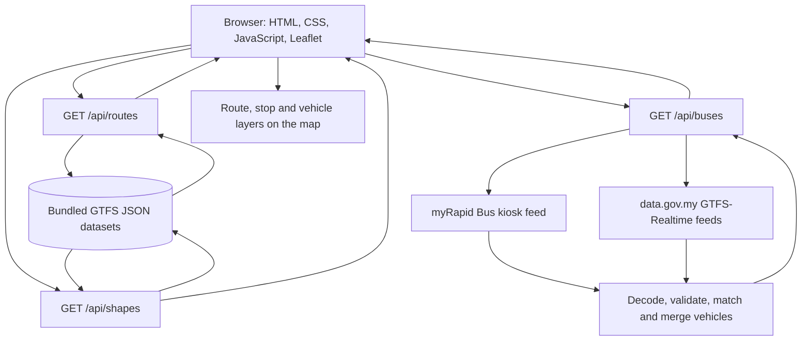

# JomNaik

### Your city, one bus away.

JomNaik is an independent public bus tracking platform for Malaysia. It brings route discovery, stop information, route geometry, and available live vehicle positions together in a responsive web interface powered by public transportation data and OpenStreetMap.

**Developed by Mohtasim Jitu**  
**Founder of Red-X Corporation**

[](https://instagram.com/mohtasimjitu)
[](https://facebook.com/mohtasimjitu)
[](https://github.com/mohtasimjitu)

---

## Overview

JomNaik helps passengers explore supported bus networks, find routes by number or destination, inspect route stops, and see vehicle locations when GPS data is available. The interface is designed for desktop and mobile browsers, with route information and the map presented together.

### Supported networks

- **Klang Valley:** RapidKL services and MRT feeder buses.
- **Penang:** Rapid Penang services.

The route catalogue is bundled with the application. Live vehicle information is requested from the upstream transit data providers when the application runs.

## Features

- Interactive map with bus routes, stops, and vehicle markers.
- Route search by route number or destination.
- Route details, available directions, stop sequences, and route geometry.
- Vehicle labels, reported speed, GPS timestamp, and data-source information when supplied.
- Automatic live-position refresh while the page is visible, plus manual refresh.
- Clear distinction between recent GPS readings and last-known positions.
- Saved routes stored in the visitor's browser.
- Shareable links that retain the selected network, route, and direction.
- Optional browser geolocation to centre the map around the visitor.
- Responsive layout for desktop and mobile devices.

## How JomNaik works

JomNaik uses a small frontend, three serverless API endpoints, locally bundled route datasets, and live transit feeds. It does not require an application database, user accounts, or an API key for the current configuration.

### System architecture



### 1. Route data is prepared from GTFS

The project uses Prasarana static GTFS feeds published through [data.gov.my](https://data.gov.my/). GTFS is a standard format for describing public transportation networks.

When the data-refresh script runs, it downloads the static GTFS ZIP files for the supported categories and processes the relevant files:

- `routes.txt` provides route identifiers, public route numbers, and route names.
- `trips.txt` connects routes to individual trips and direction identifiers.
- `stops.txt` provides stop names and geographic coordinates.
- `stop_times.txt` provides the order of stops for each trip.
- `shapes.txt` provides the geographic points used to draw a route on the map.

The compiler joins these records into JSON datasets in `data/`. For each route and direction, it selects a trip with the most stop-time records as a representative stop sequence. The selected trip's shape is stored as latitude/longitude coordinates. A trip index is also generated to help associate incoming live vehicle records with the correct route and direction.

For the Klang Valley network, RapidKL and MRT feeder datasets are combined by the data layer. Penang uses its own route dataset. If the official Klang Valley catalogue does not contain T568, the data layer can use the separately bundled community-mapped OpenStreetMap fallback. This means route browsing can use the bundled JSON files without downloading the large static GTFS archives on every page visit.

### 2. The browser requests route summaries

When a visitor opens JomNaik or changes the network, the frontend calls:

```http
GET /api/routes?category=rapid-bus-kl
```

The API reads the matching bundled dataset and returns route summaries, including route IDs, route numbers, names, and stop counts. The browser uses this response to build the searchable route list.

The frontend does not need to load every route's full stop list and geometry at startup. This keeps the initial route catalogue response smaller.

### 3. Selecting a route loads its details

When a visitor selects a route, the frontend requests its detailed route data:

```http
GET /api/shapes?category=rapid-bus-kl&route=<route-id>
```

The API returns the route's available directions. Each direction can contain an ordered list of stops and geographic route geometry. The frontend uses Leaflet to draw the route and stop markers, populate the direction selector, and fit the map to the selected route.

Some route information may be unavailable in the published catalogue. Where a route has a configured kiosk reference, the API can request additional route information from the myRapid kiosk page. A kiosk stop list is not treated as an ordered journey unless an ordered sequence is available from the route data.

### 4. Live vehicle positions are collected and combined

The browser requests vehicle information from:

```http
GET /api/buses?category=rapid-bus-kl
```

The serverless endpoint obtains the available live sources in parallel:

- **myRapid Bus kiosk:** the application opens a short-lived Socket.IO/Engine.IO polling session over HTTP and reads the returned vehicle snapshot.
- **data.gov.my GTFS-Realtime:** the application requests the relevant vehicle-position feeds and decodes their Protocol Buffers payloads using the GTFS-Realtime bindings included in the project.

For the Klang Valley network, the live request includes the RapidKL and MRT feeder GTFS-Realtime feeds. For Penang, it uses the Penang feed. The kiosk provider is selected for the corresponding network.

The incoming records use different identifiers and field formats. JomNaik converts them into a common vehicle format, validates coordinates, and matches vehicles to routes using GTFS route IDs, configured aliases, and public route numbers where possible. It records the source and GPS timestamp. Vehicle records that appear in more than one feed are deduplicated using the vehicle label or registration identifier; the record with the newest GPS timestamp is retained.

The API also reports which sources responded. When one source is unavailable but another responds, the available vehicle data can still be returned with a partial-availability indicator. If no live source responds, the endpoint returns an error rather than inventing vehicle positions.

### 5. The map displays the latest available information

The frontend updates vehicle markers and the vehicle list using the API response. It displays the vehicle label, route, reported speed where available, GPS age, and source. GPS readings older than two minutes are treated as stale and shown as last-known positions rather than recent positions.

The browser requests updated vehicle data approximately every 20 seconds while the page is visible. Polling pauses when the page is hidden and resumes when the visitor returns. A visitor can also request a manual refresh.

JomNaik displays reported vehicle positions; it does not calculate arrival predictions or guarantee that a displayed vehicle is currently carrying passengers.

### 6. Visitor preferences stay in the browser

Saved routes are stored in the browser's `localStorage`; they are not stored in a project database or synchronised between devices. Share links preserve the selected network, route, and direction in the page URL.

The location button uses the browser Geolocation API only after the visitor requests it and grants permission. The resulting location is used to centre the map in the browser; it is not sent to the JomNaik API.

## API reference

All endpoints use `GET` requests and return JSON.

| Endpoint | Purpose |
|---|---|
| `/api/routes?category=rapid-bus-kl` | Returns route summaries for the selected network. |
| `/api/shapes?category=rapid-bus-kl&route=<route-id>` | Returns one route's directions, stop information, and geometry where available. |
| `/api/buses?category=rapid-bus-kl` | Returns available vehicle positions and live-source status. |
| `/api/buses?category=rapid-bus-kl&route=<route-id>` | Returns vehicle positions filtered to the specified route. |

Supported category identifiers are `rapid-bus-kl`, `rapid-bus-mrtfeeder`, and `rapid-bus-penang`. The current interface presents RapidKL and MRT feeder services together under the Klang Valley network, with Penang as a separate network.

### Live vehicle response

The `/api/buses` response includes:

- `buses`: the normalized vehicle records.
- `count`: the number of records returned for the request.
- `fetchedAt`: when the server obtained the combined snapshot.
- `timestamp`: the newest GPS timestamp in the returned set.
- `sources`: availability status for each upstream feed.
- `partial`: indicates whether one or more upstream sources were unavailable.
- `additionalRoutes`: routes discovered in the live feed that are not in the bundled route catalogue.

Vehicle records may include an ID, label, route ID and number, coordinates, speed, bearing, GPS timestamp, stale status, and source. Some fields can be unavailable depending on what the upstream provider reports.

### Caching

The API applies different cache lifetimes according to the type of data:

| Endpoint | Cache policy |
|---|---|
| Route summaries | 1 hour shared cache |
| Route details | 5 minutes shared cache |
| Vehicle positions | 15 seconds shared cache, with 10 seconds of stale-while-revalidate |

The live-data handler also reuses recent snapshots and coalesces concurrent requests within a running function instance to avoid unnecessary duplicate upstream requests.

## Technology

| Component | Technology |
|---|---|
| Frontend | HTML5, CSS3, JavaScript |
| Mapping | Leaflet |
| Map data | OpenStreetMap |
| Backend | Node.js serverless functions |
| Local development server | Express |
| Static transit data | GTFS |
| Live transit data | GTFS-Realtime and myRapid kiosk feed |
| GTFS-Realtime decoding | Protocol Buffers bindings |
| Deployment | Vercel |

## Project structure

```text
jomnaik/
├── api/                 # Vercel serverless API endpoints
│   ├── routes.js        # Route catalogue endpoint
│   ├── shapes.js        # Route details and geometry endpoint
│   └── buses.js         # Live vehicle endpoint
├── data/                # Generated GTFS datasets and T568 map fallback
├── lib/                 # Data loading, GTFS parsing, feed processing,
│                        # route matching, and vehicle normalization
│   └── vendor/          # GTFS-Realtime Protocol Buffers bindings
├── public/              # Frontend application and static assets
│   ├── index.html
│   ├── app.js
│   ├── style.css
│   ├── config.js
│   └── vendor/          # Leaflet assets
├── scripts/             # Data refresh and production build scripts
├── test/                # Automated tests
├── licenses/            # Third-party licence notices
├── CREDITS.md           # Data, map, and software attribution
├── dev.js               # Local Express development server
├── package.json
├── package-lock.json
└── vercel.json
```

The `dist/` directory is generated by the build command. The Vercel deployment also needs the `api/`, `lib/`, and `data/` directories because the API functions read the bundled datasets at runtime.

## Getting started

### Requirements

- Node.js 22.x
- npm
- Internet access for map tiles and live transit feeds

### Run locally

Clone or download the repository, then open a terminal in the project root (the directory containing `package.json`).

Install dependencies:

```bash
npm ci
```

Start the local development server:

```bash
npm run dev
```

Open [http://localhost:4040](http://localhost:4040). To use a different port, set the `PORT` environment variable or pass `--port` to `dev.js`.

### Build and test

Create the production frontend bundle:

```bash
npm run build
```

Run the automated test suite:

```bash
npm test
```

## Updating the bundled route data

The repository includes generated route datasets so the application can serve route information without downloading static GTFS files on each request. To refresh those datasets from the published feeds, run:

```bash
npm run refresh-data
```

The script downloads the static GTFS ZIP files, processes the route, trip, stop, stop-time, and shape records, and writes the updated JSON files into `data/`.

The project also includes a community-mapped OpenStreetMap fallback for the T568 route, stored in `data/t568-osm.json`. To refresh that dataset from its OpenStreetMap relation, run:

```bash
npm run refresh-t568
```

After refreshing data, rebuild and run the tests before deploying:

```bash
npm test
npm run build
```

Review generated data changes before committing them to the repository.

## Deploying to Vercel

The project is configured for Vercel with the following settings:

| Setting | Value |
|---|---|
| Framework preset | Other |
| Build command | `npm run build` |
| Output directory | `dist` |
| Node.js | 22.x |
| Serverless function maximum duration | 30 seconds |
| Environment variables | None required by the current configuration |

To deploy with the Vercel CLI:

```bash
npm ci
npm test
npm run build
npx vercel@latest --prod
```

Follow the CLI prompts to sign in and create or select a Vercel project. Set the project root to the repository root containing `package.json` and `vercel.json`.

For a Git-based deployment, import the repository into Vercel and use the settings above. Deploy the complete source repository, not only the `dist/` directory: the serverless API functions require the `api/`, `lib/`, and `data/` directories.

## Data sources and attribution

JomNaik uses the following external data and software:

- **Prasarana Malaysia / data.gov.my:** static GTFS route data and GTFS-Realtime vehicle positions. See the [data.gov.my transportation API documentation](https://developer.data.gov.my/realtime-api/gtfs-realtime).
- **myRapid Bus:** vehicle information and route references from the [myRapid Bus kiosk](https://myrapidbus.prasarana.com.my/kiosk). The kiosk's live interface is not a documented public API and may change or become unavailable.
- **OpenStreetMap contributors:** map data and the T568 community-mapped fallback. See [OpenStreetMap copyright and attribution](https://www.openstreetmap.org/copyright).
- **Leaflet:** open-source interactive mapping library. See [Leaflet](https://leafletjs.com/).

See [`CREDITS.md`](CREDITS.md) and the [`licenses/`](licenses/) directory for detailed attribution and third-party licence notices. The T568 fallback dataset is derived from OpenStreetMap relation [19200400](https://www.openstreetmap.org/relation/19200400) and is distributed under the Open Database License (ODbL).

## Important limitations

- Live vehicle positions depend on upstream provider availability, reporting frequency, and GPS quality. A marker may represent a last-known position.
- The myRapid kiosk feed is an undocumented upstream interface and may change without notice.
- Route stop sequences are representative GTFS trips, not a complete timetable or journey planner. Individual trips may follow different stop patterns.
- JomNaik does not currently provide arrival-time predictions, fare information, seat availability, or service guarantees.
- A reported vehicle position does not confirm that the bus is accepting passengers or operating in passenger service.
- OpenStreetMap's public tile service is subject to its [usage policy](https://operations.osmfoundation.org/policies/tiles/) and does not provide a service-level guarantee. For high-traffic deployments, configure a suitable tile provider in `public/config.js` and follow that provider's terms and attribution requirements.

## Privacy

JomNaik does not require visitor accounts or a project database. Saved routes are stored locally in the visitor's browser. Geolocation is requested only after the visitor selects the location control and is used by the browser to centre the map. Map tiles and live transit information are requested from their respective providers as part of normal application use.

## Project licence

The current repository does not include a project-wide `LICENSE` file or declare a licence for the JomNaik source code. Do not assume the project itself is licensed for reuse or redistribution. Third-party software and datasets retain their respective licences; see [`CREDITS.md`](CREDITS.md) and [`licenses/`](licenses/) for details.

## Credits

**JomNaik** is developed by **Mohtasim Jitu**, Founder of **Red-X Corporation**.

- [Instagram](https://instagram.com/mohtasimjitu)
- [Facebook](https://facebook.com/mohtasimjitu)
- [GitHub](https://github.com/mohtasimjitu)

JomNaik is an independent community project and is not affiliated with, endorsed by, or an official product of Prasarana Malaysia, RapidKL, Rapid Penang, MRT, or data.gov.my.
Special thanks to the open-source community, data providers, and contributors whose work helps make projects like JomNaik possible.

<p align="center">
  <strong>JomNaik — Your City, One Bus Away.</strong>
  <br>
  An independent initiative by Mohtasim Jitu · Red-X Corporation
</p>
